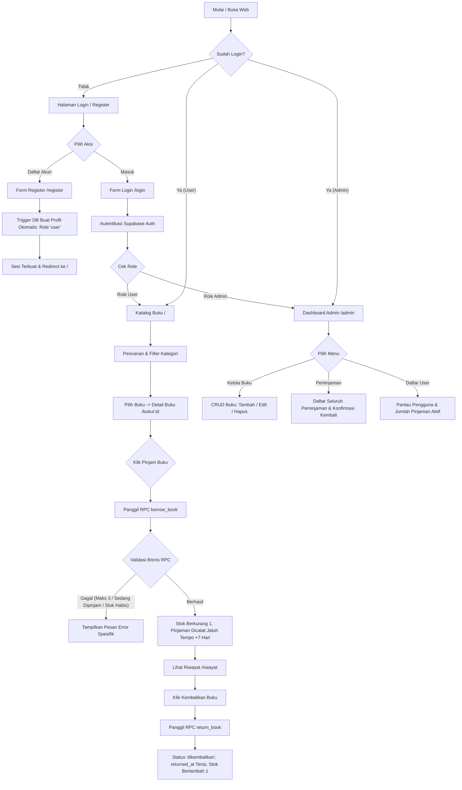
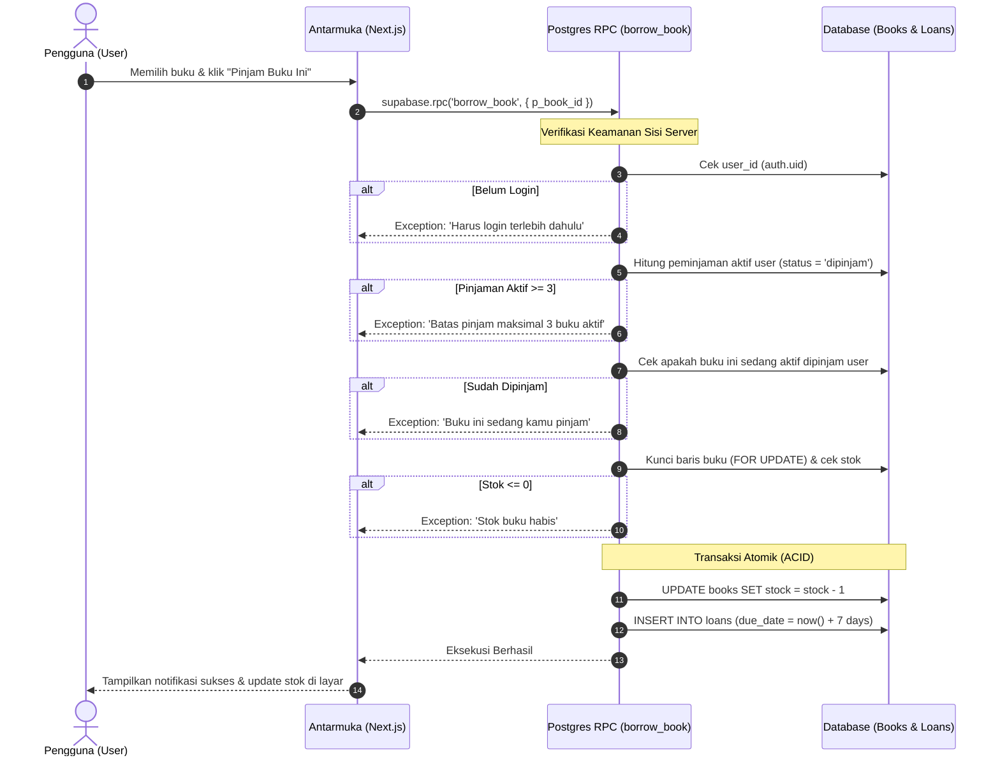
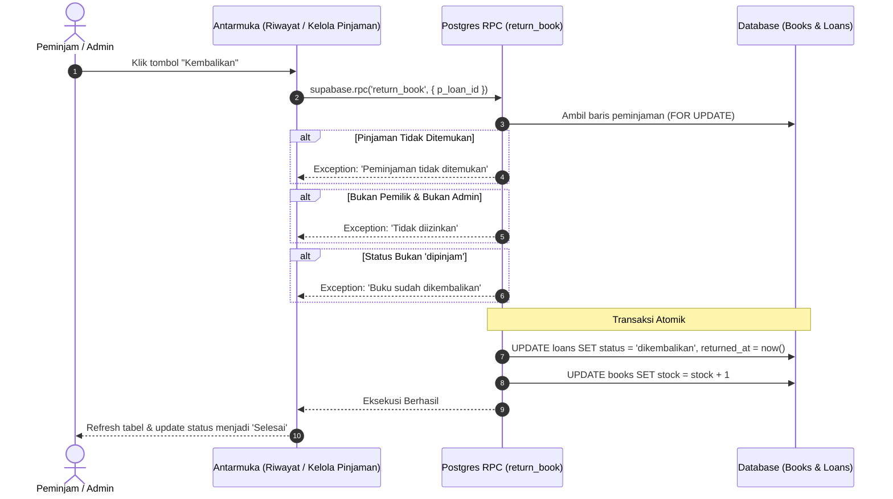
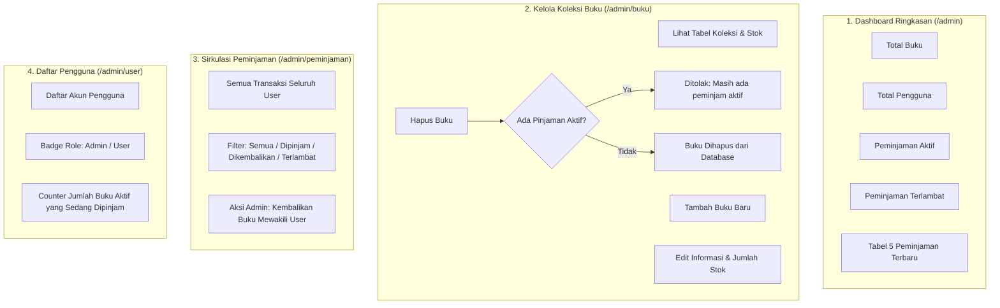
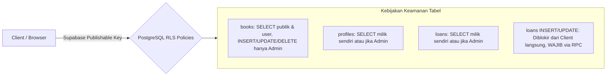
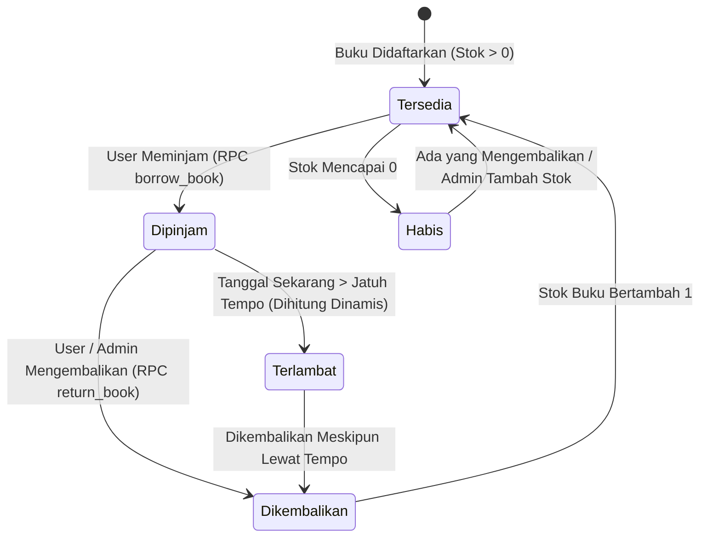

# Dokumentasi Alur Bisnis Sistem Perpus (Web Peminjaman Buku)

Dokumen ini menjelaskan arsitektur, alur bisnis, aturan validasi, siklus data, dan hak akses aplikasi **Perpus** yang dibangun menggunakan **Next.js (App Router)**, **Supabase PostgreSQL**, **Prisma ORM**, dan **Tailwind CSS**.

---

## 1. Ikhtisar Sistem & Aktor

Aplikasi memiliki **dua peran utama (Role)**:

| Peran | Deskripsi | Hak Akses Utama |
|---|---|---|
| **Admin** | Pengelola operasional perpustakaan | Mengakses Dashboard Admin, CRUD Buku, Memantau Peminjaman Seluruh User, Mengembalikan Buku User, Melihat Data Pengguna. |
| **User (Peminjam)** | Pengguna umum / anggota perpustakaan | Melihat Katalog Buku, Mencari & Memfilter Kategori, Melihat Detail & Meminjam Buku, Mengembalikan Buku yang Dipinjam, Memantau Riwayat Peminjaman Pribadi. |

---

## 2. Diagram Alur Utama (End-to-End Workflow)

---

## 3. Rincian Alur Bisnis

### 3.1. Alur Autentikasi & Pendaftaran Pengguna

1. **Registrasi (`/register`)**:
   - Pengguna menginput `Nama Lengkap`, `Email`, dan `Password` (minimal 6 karakter).
   - Sistem mendaftarkan akun ke Supabase Auth (`supabase.auth.signUp`).
   - Trigger Postgres `handle_new_user()` secara otomatis menyalin data akun ke tabel `public.profiles` dengan role default **`user`**.
   - Pengguna tidak diperbolehkan menentukan atau memanipulasi role miliknya sendiri.

2. **Login (`/login`)**:
   - Pengguna memasukkan `Email` dan `Password`.
   - Sistem memverifikasi kredensial ke Supabase Auth (`supabase.auth.signInWithPassword`).
   - Sistem mengambil informasi role dari `public.profiles`:
     - Jika role = **`admin`**, pengguna diarahkan ke `/admin`.
     - Jika role = **`user`**, pengguna diarahkan ke `/`.
   - Token sesi disimpan dengan aman dalam cookie HTTP (`perpus_session`).

3. **Logout**:
   - Pengguna mengklik tombol Logout di navbar atau sidebar.
   - Sesi di Supabase Auth ditutup (`supabase.auth.signOut`), cookie dan cache lokal dibersihkan, lalu pengguna diarahkan kembali ke `/login`.

4. **Proteksi Rute (Middleware / Proxy Guard)**:
   - Pengguna yang belum login otomatis dialihkan ke `/login` jika mencoba membuka rute tertutup.
   - Pengguna ber-role `user` yang mencoba mengakses rute `/admin/*` akan langsung dipaksa kembali (*redirect*) ke `/`.

---

### 3.2. Alur Peminjaman Buku (User)

#### Aturan Bisnis Peminjaman:
1. **Batas Kuota Pinjam**: 1 user maksimal hanya boleh memiliki **3 peminjaman aktif** (`status = 'dipinjam'`). Pinjaman ke-4 akan otomatis ditolak oleh database.
2. **Durasi Peminjaman**: Ditentukan otomatis selama **7 hari** terhitung dari detik transaksi peminjaman (`due_date = now() + interval '7 days'`).
3. **Pencegahan Duplikasi**: Pengguna tidak dapat meminjam buku yang sama jika buku tersebut masih belum dikembalikan.
4. **Konsistensi Stok Atomik**: Pemotongan stok dilakukan di dalam fungsi RPC dengan row-level lock (`SELECT ... FOR UPDATE`), mencegah kondisi *race condition* (misalnya 2 user meminjam bersamaan ketika sisa stok tinggal 1).

---

### 3.3. Alur Pengembalian Buku

#### Aturan Bisnis Pengembalian:
1. **Otorisasi**: Buku hanya boleh dikembalikan oleh peminjam yang bersangkutan ATAU oleh akun dengan role **Admin**.
2. **Pencegahan Pengembalian Ganda**: Jika status sudah `'dikembalikan'`, pengembalian ulang akan ditolak.
3. **Restorasi Stok Otomatis**: Stok buku bertambah 1 secara atomik bersamaan dengan pembaruan status peminjaman dan pencatatan tanggal kembali (`returned_at`).

---

### 3.4. Logika Perhitungan Status & Keterlambatan (Overdue)

Status peminjaman dihitung secara dinamis saat data dibaca:

| Status Visual | Kondisi Logika | Keterangan |
|---|---|---|
| **Dipinjam** | `status == 'dipinjam'` dan `now() <= due_date` | Peminjaman normal dalam batas waktu 7 hari. |
| **Terlambat** | `status == 'dipinjam'` dan `now() > due_date` | Melewati batas tempo 7 hari. Menampilkan badge merah dan jumlah hari keterlambatan (`Terlambat (X hari)`). |
| **Dikembalikan** | `status == 'dikembalikan'` | Peminjaman sudah selesai dikembalikan. Tanggal pengembalian tercatat di kolom `returned_at`. |

---

### 3.5. Alur Bisnis Panel Admin

#### Aturan Khusus Operasional Admin:
1. **Integritas Penghapusan Buku**: Admin **tidak dapat menghapus buku** yang masih tercatat memiliki peminjaman aktif (`status = 'dipinjam'`). Admin wajib menunggu buku dikembalikan terlebih dahulu agar riwayat data peminjaman tidak rusak (*orphan foreign key*).
2. **Kontrol Stok**: Admin dapat menyesuaikan stok buku secara manual saat menambah atau mengedit buku (stok minimal 0).
3. **Fleksibilitas Pengembalian**: Jika peminjam mengembalikan buku secara fisik ke perpustakaan, petugas Admin dapat memproses pengembalian buku tersebut melalui menu `/admin/peminjaman`.

---

## 4. Keamanan & Proteksi Data (Row Level Security)

Keamanan aplikasi tidak hanya bertumpu pada antarmuka (frontend), melainkan ditegakkan langsung di level database PostgreSQL melalui **Row Level Security (RLS)**:

1. **Tabel `books`**:
   - `SELECT`: Diizinkan untuk semua pihak (publik dan authenticated) agar katalog dapat dilihat.
   - `INSERT / UPDATE / DELETE`: Hanya diizinkan jika `public.is_admin() = true`.
2. **Tabel `profiles`**:
   - Hanya pengguna pemilik profil (`id = auth.uid()`) atau Admin yang dapat membaca data profil.
3. **Tabel `loans`**:
   - Pengguna biasa hanya dapat membaca riwayat miliknya sendiri (`user_id = auth.uid()`).
   - Admin dapat membaca seluruh baris peminjaman.
   - Manipulasi langsung (`INSERT` / `UPDATE` manual dari frontend) dilarang. Semua perubahan data mutlak melalui fungsi RPC `borrow_book` dan `return_book`.

---

## 5. Ringkasan Siklus Status Data

Dokumentasi ini mencakup seluruh spesifikasi dan implementasi aplikasi Perpus sesuai dengan kriteria yang ditentukan.
